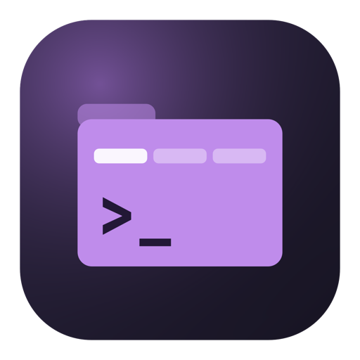

<div align="center">



# Agent Organizer

**Every project a tab. Every AI agent a session that never dies.**

A native macOS home for Claude Code, OpenCode and plain shells — organized per project folder,
persistent across app restarts, and aware of when an agent needs you.


</div>

---

## Why

Running several AI coding agents across several repos means a pile of terminal windows, and losing track of which one is
working, which one is waiting for you, and which one died when you quit your terminal.

Agent Organizer gives each project **folder** a spot in the sidebar and each **agent** a tab inside it. Every agent runs in
its own [tmux](https://github.com/tmux/tmux) session, so **quitting the app never kills your agents** — reopen it and
everything is exactly where you left it.

## Features

- **Folders as vertical tabs.** Git repos, containers of repos (with per-repo branch badges), or plain directories.
- **Agents as horizontal tabs.** Claude Code, OpenCode, a login shell, or your own custom presets (with resume commands).
- **Sessions survive the app.** Each agent is a tmux session on the app's *own* socket — your personal tmux is never touched.
- **Live status, no polling.** A status icon per agent (blue spinner running, orange ! needs you, green ✓ finished, grey idle, red × exited), optionally as sidebar row colours, driven by tmux control-mode events:
  `running` · `waiting for input` · `idle` · `exited`.
- **Knows when Claude needs you.** Claude Code hooks flag the tab, bounce the Dock, badge the icon and ring a sound — silent
  while you're already looking at that tab. Tools without hooks (OpenCode, custom) get the same via output-quiet detection.
- **Sub-agent aware.** An agent whose background sub-agents are still working stays *running* instead of looking finished.
- **Auto-named tabs.** Tabs pick up Claude Code's own topic summary; rename any tab to pin your own title.
- **Side-by-side split** of two agents in the same folder.
- **Remote folders over SSH.** Agents run in tmux on a remote box (e.g. a devbox). Pasted files and images are uploaded
  for you, URLs the remote opens come back to your Mac browser, and OAuth `localhost` callbacks are forwarded.
- **Rebindable shortcuts** for everything, plus the editor-style word/line keys terminals usually lack.
- **Per-agent resource usage** (CPU / memory) at a glance.
- **Small and native.** Swift + SwiftUI + [SwiftTerm](https://github.com/migueldeicaza/SwiftTerm). No Electron, no WebView.

## Install

Grab the DMG (or build it yourself, below), drag **Agent Organizer** to `/Applications`, and launch it.

The app is signed with a local self-signed identity, so on first launch you may need to right-click → **Open**.

Then, for attention alerts from Claude Code: **Settings › General › Claude Code hooks › Install**. This merges a few entries into
`~/.claude/settings.json` (other tools' hooks are left alone and a one-time backup is written). Restart any Claude agents
that were already running — Claude snapshots hooks at startup.

## Keyboard

Defaults (all rebindable in Settings › Shortcuts):

| Action | Shortcut |
|---|---|
| New agent | `⌘N` |
| New shell | `⌘T` |
| Add folder | `⇧⌘O` |
| Next / previous tab | `⇧⌘]` / `⇧⌘[` |
| Kill agent | `⌘W` |
| Close window | `⇧⌘W` |

## Build from source

Requires macOS 14+ and the Swift 6 toolchain (Command Line Tools are enough — **no Xcode needed**).

```sh
git clone git@github.com:RandalVanheede/agent-organizer.git
cd agent-organizer

make            # build/Agent Organizer.dmg
make run        # build, stage and launch the app
make install    # copy to /Applications
swift build -c release   # compile only, fastest error check
```

Other targets: `make tmux` (rebuild the bundled static tmux), `make icon`, `make identity` (create the self-signed
signing identity so permissions survive rebuilds).

## How it works

```
┌─────────────────────── Agent Organizer.app ───────────────────────┐
│ SwiftUI: sidebar (folders) · tab bar (agents) · SwiftTerm view    │
│    └─ child process: tmux attach -t <session> ──────────┐         │
│ control-mode client (tmux -C) ──── push events ─────────┼───┐     │
└─────────────────────────────────────────────────────────┼───┼─────┘
                                                          ▼   ▼
                          tmux server on the app's own socket (outlives the app)
                            ao_<folder>_<id> → login shell → claude / opencode / …
```

- The app never owns an agent's PTY; it's just a window onto a tmux session. Switching tabs re-parents a cached terminal view.
- Status comes from a single tmux control-mode client and a format subscription — idle CPU stays near zero.
- Claude Code hooks drop small JSON files into `~/Library/Application Support/Agent Organizer/events/`, picked up by a
  directory watcher.
- All state lives in `~/Library/Application Support/Agent Organizer/state.json`. Delete it for a clean slate; your tmux
  sessions are unaffected.

See [`PLAN.md`](PLAN.md) for the full design and milestone history, and [`CLAUDE.md`](CLAUDE.md) for architecture notes.

## Status

Personal project, built for daily use. Local builds can't get macOS system-notification permission, so alerts appear as
in-app toasts, Dock badge and sound instead.
